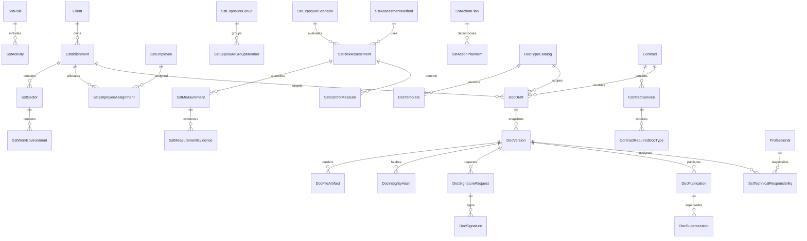

# Phase 07A - Canonical Technical SST Modeling

## 0. Scope and Constraints

This document defines the canonical architecture and functional modeling for the SST technical core, with PGR as pilot and support for:

1. PGR
2. PCMSO
3. LTCAT
4. Insalubridade Report (NR-15)
5. Periculosidade Report (NR-16)
6. PCMSO Analytical Report

This is planning only. No migration, DB change, endpoint implementation, UI implementation, commit, push, deploy, or external provider integration is performed in this phase.

## 1. Current Baseline (Evidence)

- Roadmap phases 01-06 are completed and phase 07 starts the technical core: `DEVELOPMENT_ROADMAP.md`.
- Current API modules include auth, users, professionals, clients, service catalog, contracts, client portal, finance: `apps/api/src/app.ts`.
- Current Prisma schema covers auth, client, contract, financial, and audit domains; no SST technical-core entities exist yet: `apps/api/prisma/schema.prisma`.
- Admin routes `gestao-sst`, `documentos`, and `relatorios` are placeholders: `apps/web/src/app/app-router.tsx` and `apps/web/src/routes/placeholder-page.tsx`.
- Client portal documents page is not implemented yet (explicit empty state): `apps/web/src/routes/client-portal-documents-page.tsx`.

## 2. Canonical Shared Technical Model

### 2.1 Reused Entities (already implemented)

- `Client`
- `Establishment`
- `Contract`
- `ContractService`
- `Professional`
- `User`
- `AuditLog`

These entities remain source-of-truth for commercial relationship, legal entity hierarchy, identity, and core audit trail.

### 2.2 New Proposed Core Entities (no DB change applied)

Organizational and occupational structure:

- `SstSector`
- `SstWorkEnvironment`
- `SstRole` (job role with CBO)
- `SstActivity`
- `SstWorkSchedule`
- `SstEmployee` (administrative identity, non-medical)
- `SstEmployeeAssignment` (employee to establishment/sector/role)
- `SstExposureGroup` (GHE/GES)
- `SstExposureGroupMember`

Risk and prevention structure:

- `SstHazard`
- `SstAgent` (physical, chemical, biological, ergonomic, accident)
- `SstRiskSource`
- `SstExposureScenario`
- `SstAssessmentMethod`
- `SstRiskAssessment` (qualitative/quantitative)
- `SstMeasurement`
- `SstMeasurementEvidence`
- `SstControlMeasure`
- `SstEpi`
- `SstEpc`
- `SstActionPlan`
- `SstActionPlanItem`

Occupational health planning (separation of sensitive data):

- `OccHealthProgramPlan`
- `OccHealthExamType`
- `OccHealthExamMatrixRule` (exam planning by role/risk)
- `OccHealthExamPlan`
- `OccHealthIndicatorAggregate` (aggregated, non-identifiable)
- `OccHealthMedicalVaultRef` (pointer/reference only, no sensitive payload)

Technical responsibility and governance:

- `SstTechnicalResponsibility`
- `SstDocumentResponsibilityHistory`
- `SstReviewDecision`
- `SstApprovalDecision`

## 3. Document Engine Canonical Model

### 3.1 Document Catalog and Templates

- `DocTypeCatalog`
  - canonical document type list (PGR, PCMSO, LTCAT, etc.)
  - applicability rules (client, establishment, legal trigger)
- `DocTemplate`
  - type-scoped template
  - semantic versioning (major/minor/patch)
  - activation/deprecation controls

### 3.2 Draft, Snapshot, Publication, Archive

- `DocDraft`
  - editable assembly state
  - AI suggestions tracked and editable
- `DocVersion`
  - immutable snapshot produced from draft + template version + data references
- `DocPublication`
  - published version metadata and validity window
- `DocSupersession`
  - links previous version superseded by a new publication
- `DocArchiveRecord`
  - archive metadata and reason

### 3.3 Signatures and Integrity

- `DocSignatureRequest`
- `DocSignature`
- `DocFileArtifact`
- `DocIntegrityHash`

### 3.4 Evidence and Audit

- `DocEvidenceLink`
- `DocGenerationTrace`

## 4. State Model and Transitions

### 4.1 Lifecycle states

- `OPERATIONAL_DATA_EDITABLE`
- `DRAFT_IN_PROGRESS`
- `DRAFT_PENDING_DATA`
- `DRAFT_READY_FOR_REVIEW`
- `TECH_REVIEW_IN_PROGRESS`
- `TECH_REVIEW_REJECTED`
- `TECH_APPROVED`
- `SIGNATURE_PENDING`
- `SIGNED_NOT_EFFECTIVE`
- `PUBLISHED_EFFECTIVE`
- `PUBLISHED_SUPERSEDED`
- `ARCHIVED`

### 4.2 Transition rules

- Signed is not automatically effective.
- Effectiveness requires document-type specific checks:
  - required chapter completeness,
  - mandatory evidences,
  - technical responsibility completeness,
  - approval constraints,
  - validity start criteria.
- Supersession never mutates immutable snapshots; it creates a new version and links replacement.

## 5. Entity Relationship Diagram (logical)



## 6. Data Dictionary (canonical, high-level)

### 6.1 Organizational axis

- `SstSector`: id, establishmentId, code, name, description, isActive.
- `SstWorkEnvironment`: id, sectorId, code, name, description, indoorOutdoorType, isActive.
- `SstRole`: id, clientId, title, cboCode, cboDescription, isActive.
- `SstActivity`: id, roleId, title, frequency, description, isCritical.
- `SstWorkSchedule`: id, establishmentId, scheduleType, weeklyHours, shiftPattern.
- `SstEmployee`: id, clientId, employeeCode, fullName, employmentType, active.
- `SstEmployeeAssignment`: id, employeeId, establishmentId, sectorId, roleId, scheduleId, startDate, endDate.
- `SstExposureGroup`: id, establishmentId, groupCode, groupType(GHE|GES), description.

### 6.2 Risk axis

- `SstHazard`: id, environmentId, title, hazardClass, legalReference, active.
- `SstAgent`: id, hazardId, agentType, agentName, casNumber(optional), active.
- `SstRiskSource`: id, agentId, sourceType, sourceDescription.
- `SstExposureScenario`: id, establishmentId, environmentId, roleId, activityId, narrative.
- `SstAssessmentMethod`: id, methodCode, methodName, methodKind, referenceNorm.
- `SstRiskAssessment`: id, scenarioId, methodId, qualitativeLevel, quantitativeFlag, conclusion, assessedAt.
- `SstMeasurement`: id, assessmentId, metricName, unit, measuredValue, limitValue, samplingStrategy, measuredAt.
- `SstMeasurementEvidence`: id, measurementId, fileArtifactId, source, note.
- `SstControlMeasure`: id, assessmentId, controlType(EPC|EPI|ADMIN|PROCESS), description, effectivenessLevel.
- `SstEpi`: id, controlMeasureId, name, caNumber, validityDate.
- `SstEpc`: id, controlMeasureId, name, standardRef.
- `SstActionPlan`: id, establishmentId, originAssessmentId, status, ownerProfessionalId, dueDate.
- `SstActionPlanItem`: id, actionPlanId, title, priority, responsibleParty, dueDate, completionStatus.

### 6.3 Occupational health axis

- `OccHealthProgramPlan`: id, clientId, establishmentId, validityStart, validityEnd, coordinatorProfessionalId.
- `OccHealthExamType`: id, code, name, periodicityRule, isMandatoryByLawFlag.
- `OccHealthExamMatrixRule`: id, roleId, exposureGroupId, examTypeId, triggerRule, periodicityMonths.
- `OccHealthExamPlan`: id, programPlanId, employeeAssignmentId(optional), roleId, examTypeId, plannedDate, status.
- `OccHealthIndicatorAggregate`: id, programPlanId, indicatorCode, indicatorValue, calculationPeriod, sourceRef.
- `OccHealthMedicalVaultRef`: id, externalVaultKey, legalBasis, retentionPolicy, lastSyncAt.

### 6.4 Document axis

- `DocTypeCatalog`: id, code, name, scopeLevel(CLIENT|ESTABLISHMENT), defaultValidityMonths(optional), active.
- `DocTemplate`: id, docTypeId, version, schemaVersion, chapterBlueprint, activeFrom, deprecatedAt.
- `DocDraft`: id, docTypeId, clientId, establishmentId(optional), contractId(optional), status, createdByUserId.
- `DocVersion`: id, draftId, versionNumber, immutableSnapshotJson, templateVersion, generationMode(MANUAL|AI_ASSISTED), generatedByUserId.
- `DocPublication`: id, docVersionId, publicationStatus, validFrom, validUntil(optional), publishedByUserId.
- `DocSupersession`: id, previousPublicationId, newPublicationId, reason.
- `DocArchiveRecord`: id, publicationId, archivedAt, archiveReason, archivedByUserId.
- `DocSignatureRequest`: id, docVersionId, signerRole, signerProfessionalId(optional), signerUserId(optional), status.
- `DocSignature`: id, signatureRequestId, providerType, signatureRef, signedAt, certificateInfoJson(optional).
- `DocFileArtifact`: id, docVersionId, storageKey, mimeType, sizeBytes, checksumSha256.
- `DocIntegrityHash`: id, docVersionId, hashAlgorithm, hashValue, generatedAt.
- `DocEvidenceLink`: id, docVersionId, evidenceType, linkedEntityType, linkedEntityId, note.
- `DocGenerationTrace`: id, docVersionId, templateId, templateVersion, sourceDatasetHash, aiProviderVersion(optional), generatedAt.

### 6.5 Responsibility axis

- `SstTechnicalResponsibility`: id, docVersionId, professionalId, responsibilityType(AUTHOR|REVIEWER|APPROVER), licenseType, councilCode, registrationNumber, uf.
- `SstDocumentResponsibilityHistory`: id, docVersionId, oldProfessionalId, newProfessionalId, reason, changedAt.
- `SstReviewDecision`: id, docVersionId, reviewerProfessionalId, decision(APPROVE|REQUEST_CHANGES|REJECT), comments, decidedAt.
- `SstApprovalDecision`: id, docVersionId, approverProfessionalId, decision(APPROVE|REJECT), comments, decidedAt.

## 7. Matrix of the Six Documents

## 7.1 Shared data baseline (all six)

- Client and establishment identification.
- Scope and applicability.
- Organizational context (sector/environment/role/activity).
- Risks or health planning source data.
- Technical responsibility and legal registration data.
- Evidence set and revision history.
- Version metadata and integrity hash.

## 7.2 Per-document matrix

| Document | Required core data | Shared data | Specific data | Inspection inputs | Measurement inputs | Required technical profile | Approval and signatures | Evidence | Review rules | Dependencies |
|---|---|---|---|---|---|---|---|---|---|---|
| PGR | Inventory of hazards, exposure scenarios, controls, action plan | Client, establishment, sector, environment, role | Risk prioritization logic and action timeline | Mandatory | Recommended/mandatory by scenario | Safety engineer or legal equivalent | Technical approval + signature | Photos, checklists, records | Periodic or event-driven update | Foundation for PCMSO matrix quality |
| PCMSO | Exam planning matrix by role/risk, coordinator physician, occupational program cycle | Client, establishment, role, exposure groups | Exam policy and execution planning | Recommended | Uses risk outputs and possible clinical aggregate indicators | Occupational physician | Medical technical approval + signature | Planning records and aggregate indicators | Annual and event-driven review | Depends on risk inventory quality |
| LTCAT | Environmental conditions and exposure characterization for social-security purpose | Client, establishment, role, environment | Previdenciary framing and conclusion basis | Mandatory | Usually mandatory where quantification applies | Qualified SST professional per legal framing | Technical approval + signature | Measurement reports and instruments metadata | Review on process/condition change | Reuses risk and measurement model |
| Insalubridade Report | Agent exposure and insalubridade framing | Client, establishment, role, activities | NR-15 framing and degree conclusion | Mandatory | Often required for threshold comparison | Qualified SST professional | Technical approval + signature | Measurement and method traceability | Review on exposure/control changes | Reuses hazard/agent/measurement |
| Periculosidade Report | Dangerous-condition framing and operational characterization | Client, establishment, role, activities | NR-16 framing and dangerous activity analysis | Mandatory | Context dependent | Qualified SST professional | Technical approval + signature | Inspection evidence and contextual records | Review on operational change | Reuses environment/activity model |
| PCMSO Analytical Report | Aggregated health indicators and trend analysis | Client, establishment, period, exam plan context | Aggregated outcomes and action recommendations | Optional | Aggregate indicators only; no sensitive raw medical data | Occupational physician | Medical approval + signature | Aggregated dashboards and references | Periodic cycle review | Depends on PCMSO planning and aggregate data quality |

Items requiring legal/technical validation before implementation:

- Exact minimum chapter list and mandatory annexes per document type.
- Who can legally sign each document type and in which jurisdictional context.
- Whether dual approval is mandatory for certain document types.
- Trigger cadence (annual, biennial, event-driven) per document category.
- Validity semantics (signed date vs effective date) by legal use-case.

## 8. AI-Assisted Automation Architecture

### 8.1 Safety principles

- AI can access only authorized tenant-scoped data.
- AI never fabricates measurements, legal conclusions, or sign-off decisions.
- Missing data becomes explicit pending items.
- AI-generated text blocks are tagged, editable, and auditable.

### 8.2 Provider abstraction (no integration now)

- `AiProviderAdapter` interface:
  - `prepareContext()`
  - `generateSections()`
  - `summarizePendingData()`
  - `explainSources()`
- `AiGenerationPolicy`:
  - max scope,
  - allowed fields,
  - forbidden sections,
  - mandatory citations to source references.

### 8.3 Traceability

Each generation stores:

- template id/version,
- source entity references,
- source dataset hash,
- model/provider metadata,
- generated section map,
- pending items list.

## 9. Contract, Service, and Document Relationship Model

New proposed join entities (planning only):

- `ContractRequiredDocType`
  - links contract service to required document types.
- `ContractDocumentInstance`
  - binds a concrete document lifecycle to contract and establishment scope.
- `DocumentManualUpload`
  - stores manually uploaded files under same governance and signature/audit model.

Rules:

- One contract may require many document types.
- One document type may recur by establishment and by validity cycle.
- Generated documents and manual uploads share a unified index but different provenance.

## 10. Authorization Proposal (new permissions)

No current permission is removed. New logical permission groups:

- `sst.structure.read`, `sst.structure.manage`
- `sst.risk.read`, `sst.risk.manage`
- `sst.measurement.read`, `sst.measurement.manage`
- `sst.occHealth.read`, `sst.occHealth.manage`
- `sst.documents.read`, `sst.documents.draft.manage`
- `sst.documents.review`, `sst.documents.approve`
- `sst.documents.publish`
- `sst.signatures.request`, `sst.signatures.sign`, `sst.signatures.validate`
- `sst.evidence.manage`
- `sst.ai.assist.generate`

Role-mapping to be finalized in 07B based on legal-signature validation and segregation-of-duty policy.

## 11. Planned Prisma Models (proposal only, no apply)

Illustrative draft of model families:

```prisma
// Core structure
model SstSector { ... }
model SstWorkEnvironment { ... }
model SstRole { ... }
model SstActivity { ... }
model SstWorkSchedule { ... }
model SstEmployee { ... }
model SstEmployeeAssignment { ... }
model SstExposureGroup { ... }
model SstExposureGroupMember { ... }

// Risk and measurement
model SstHazard { ... }
model SstAgent { ... }
model SstRiskSource { ... }
model SstExposureScenario { ... }
model SstAssessmentMethod { ... }
model SstRiskAssessment { ... }
model SstMeasurement { ... }
model SstMeasurementEvidence { ... }
model SstControlMeasure { ... }
model SstEpi { ... }
model SstEpc { ... }
model SstActionPlan { ... }
model SstActionPlanItem { ... }

// Occupational health (sensitive-data split)
model OccHealthProgramPlan { ... }
model OccHealthExamType { ... }
model OccHealthExamMatrixRule { ... }
model OccHealthExamPlan { ... }
model OccHealthIndicatorAggregate { ... }
model OccHealthMedicalVaultRef { ... }

// Document engine
model DocTypeCatalog { ... }
model DocTemplate { ... }
model DocDraft { ... }
model DocVersion { ... }
model DocPublication { ... }
model DocSupersession { ... }
model DocArchiveRecord { ... }
model DocSignatureRequest { ... }
model DocSignature { ... }
model DocFileArtifact { ... }
model DocIntegrityHash { ... }
model DocEvidenceLink { ... }
model DocGenerationTrace { ... }

// Responsibility and governance
model SstTechnicalResponsibility { ... }
model SstDocumentResponsibilityHistory { ... }
model SstReviewDecision { ... }
model SstApprovalDecision { ... }

// Contract-document bridge
model ContractRequiredDocType { ... }
model ContractDocumentInstance { ... }
model DocumentManualUpload { ... }
```

## 12. Planned API Contracts (no implementation)

### 12.1 Client detail tabs data contract

Target endpoint family:

- `GET /api/v1/clients/:id/overview`
  - aggregates for tabs: cadastro, estabelecimentos, contratos, laudos SST, documentos, funcionarios e riscos, assinaturas.
- `GET /api/v1/clients/:id/sst/documents-summary`
  - status cards by document type.
- `GET /api/v1/clients/:id/sst/establishments/:establishmentId/documents`
  - detailed document list for establishment.

### 12.2 Core SST endpoints

- Structure:
  - `/sst/sectors`
  - `/sst/work-environments`
  - `/sst/roles`
  - `/sst/activities`
  - `/sst/employees`
  - `/sst/exposure-groups`
- Risk:
  - `/sst/hazards`
  - `/sst/agents`
  - `/sst/assessments`
  - `/sst/measurements`
  - `/sst/action-plans`
- Occupational health:
  - `/sst/occ-health/programs`
  - `/sst/occ-health/exam-rules`
  - `/sst/occ-health/exam-plans`

### 12.3 Document engine endpoints

- `/sst/doc-types`
- `/sst/templates`
- `/sst/doc-drafts`
- `/sst/doc-versions`
- `/sst/doc-publications`
- `/sst/signature-requests`
- `/sst/document-files`
- `/sst/manual-uploads`

All payloads must include tenant and scope checks based on existing auth and membership constraints.

## 13. Planned UI Structure (Clients -> Client Detail)

Target tabs:

1. Cadastro
2. Estabelecimentos
3. Contratos
4. Laudos SST
5. Documentos
6. Funcionarios e riscos
7. Assinaturas

### 13.1 Laudos SST tab (status cards)

Per document type card:

- document type name,
- current lifecycle status,
- effective validity window,
- pending data count,
- pending review flag,
- signature status,
- actions according to permission and state.

### 13.2 Documentos tab

Unified repository view:

- generated documents,
- manually uploaded documents,
- source/provenance indicator,
- version chain,
- integrity and signature visibility,
- lifecycle status and archive status.

## 14. Signature Strategy

Abstract provider strategy:

- provider-neutral signature request model,
- local integrity first (hash + artifact immutability),
- optional external signature provider adapters in later phase,
- signer-role validation before request emission,
- full validation record persisted for each signature.

Legal-signature profile mapping per document type must be validated in 07B before implementation.

## 15. Storage Strategy

Proposed storage layers:

- metadata in relational DB,
- binary artifacts in private object storage,
- immutable checksum in `DocIntegrityHash`,
- restricted access with short-lived signed URLs,
- retention and archive policy by document type.

No production storage integration is performed in this phase.

## 16. Acceptance Criteria to Start Phase 07B

Phase 07A is considered complete when:

1. Canonical entity model is approved by product and technical leads.
2. Data dictionary is validated for scope and naming consistency.
3. Six-document matrix is reviewed by technical SST and legal stakeholders.
4. Document lifecycle and state transitions are approved.
5. Sensitive medical-data separation strategy is approved.
6. New permission domains are approved for RBAC extension.
7. Prisma model proposal is reviewed without migration execution.
8. Planned API contracts are approved for implementation order.
9. UI tab contracts for client detail are approved.
10. AI and signature strategies are approved with risk controls.
11. Storage and integrity strategy is approved.
12. Implementation sequence for 07B is explicitly prioritized.

## 17. Risks and Open Questions

- Legal-signature requirements can vary by document type and jurisdiction.
- Normative chapter minimums need legal and technical confirmation before locking templates.
- Medical-sensitive data governance may require additional compliance controls.
- Measurement methodology traceability needs agreed normalization set.
- Contract-to-document obligations may require configurable policy by service package.

## 18. Non-Goals Confirmed for 07A

- No schema migration.
- No DB write operation.
- No API endpoint implementation.
- No frontend implementation.
- No changes in finance domain behavior.
- No auth baseline changes.
- No commit, push, or deploy.